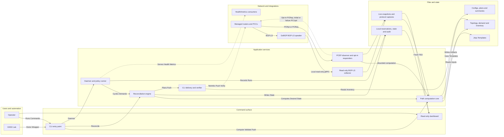
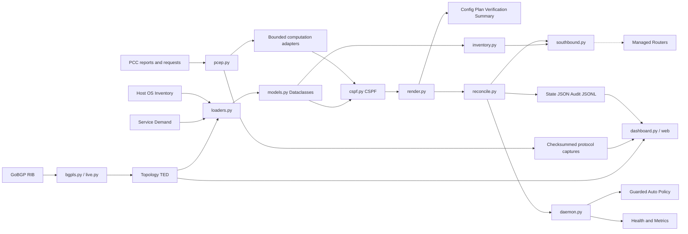

# ninja-pce architecture

This view shows the current runtime shape of `ninja-pce`. Operator files or
live GoBGP snapshots supply the TE graph; the shared computation core selects
directional RSVP-TE paths. CLI delivery and bounded PCEP responses have separate
authorization boundaries. The dashboard observes files and cannot change routers.

## Runtime flow

## Current boundaries

- Routers perform RSVP signaling and final admission. The PCEP listener observes
  by default; explicit bindings enable constrained PCReq/PCRep or initial PCUpd
  for delegated DOWN/empty-ERO LSPs. A separate opt-in profile replaces one
  authorized path after validated withdrawal of a previously mapped edge;
  initial-only configuration does not enable it. Unit/socket coverage and one
  successful IOS XE 16.9.7 lab withdrawal trial exist. That result does not
  qualify broader autonomous recovery. General active optimization,
  PCReq reoptimization and PCInitiate remain unsupported.
- CLI delivery is preview-first. A real push requires an exact reviewed plan ID
  with `--execute --approve --approved-plan-id`, or an explicit guarded-auto
  policy plus fresh, complete authoritative evidence and all delivery gates.
- The current live BGP-LS feed preserves directional TE attributes and withdrawals
  but cannot establish physical state or per-LSP ownership. It is non-authoritative
  for guarded automatic CLI writes. Static sample YAML is also non-authoritative.
- PCEP reports are not integrated with local reservation holds. Durable delegated
  ownership, authenticated PCEPS, distributed fencing and general recovery remain
  future work. The narrow withdrawal journal retains uncertain operations but is
  not the shared ledger or controller leadership. Filesystem locks coordinate one
  shared local state directory.
- Actual qualification covers a six-router CSR1000v IOS XE 16.9.7 lab. XR/Junos
  CLI dialects remain candidate adapters backed by documentation and mocks.
  A rendered configuration is not a platform or multi-vendor certification.
- The read-only dashboard distinguishes source freshness, reported state,
  acknowledgment and advertised RSVP reservations. It does not verify forwarding.
  The proposed headend/destination/bandwidth Create flow is not implemented.

See [implemented PCEP scope](pcep_computation.md),
[bounded failure recovery](pcep_failure_recovery.md),
[live withdrawal qualification](pcep_failure_recovery_validation.md),
[proposed dashboard creation](dashboard_tunnel_creation.md),
[live qualification](live_pcep_computation_validation.md),
[platform support](platform_support.md) and
[stateful ownership design](stateful_pce_architecture.md) for precise limits.
