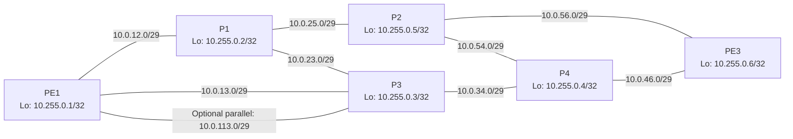
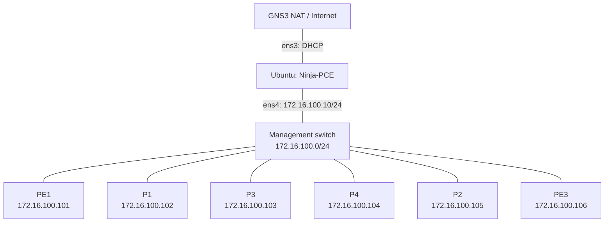

# GNS3 preparation and repeatable validation

**Device tests: NOT EXECUTED.** Initial remediation used offline computation
and synthetic parser fixtures. On 2026-10-10 the operator supplied a partial
version capture from an IOS XE 16.9.7 Virtual XE router and Ubuntu guest hardware
and interface output. This is preparation evidence, not an operational RSVP-TE
test. No router connection has been attempted by the remediation tools.

## Start here: the available IOS XE router and Ubuntu node

The Ubuntu `pce-ninja` VM runs Ninja-PCE as a guest in the same GNS3 project as
the routers. It has 4 vCPUs, 3.8 GiB RAM and approximately 17 GiB free storage.
Use a Python virtual environment on this node. Ninja-PCE does not need
`/dev/kvm`; router emulation belongs to the GNS3 compute server, not this guest.

The operator confirmed this cabling and interface assignment:

| Ubuntu NIC | Reported MAC | GNS3 connection | Addressing |
|---|---|---|---|
| `ens3` | `02:00:00:00:00:10` | NAT node / existing Internet network | DHCP; default route and DNS |
| `ens4` | `02:00:00:00:00:11` | Isolated router management switch | `172.16.100.10/24`; no gateway |

Connect router management ports to that management switch. Keep router core
links separate. The NAT node provides outbound package/Git access; its DHCP
subnet must differ from `172.16.100.0/24`. Use the NAT node on the appropriate
GNS3 compute server; do not install a nested hypervisor in Ubuntu for this setup.
See the [GNS3 NAT node documentation](https://docs.gns3.com/docs/using-gns3/advanced/the-nat-node).

### 1. Restore carrier, then configure Ubuntu addressing

Both reported NICs have administrative `UP` but `NO-CARRIER`. Connect the
virtual cables, check the appliance adapter/MAC mapping and start the connected
nodes. Changing an IP address cannot repair an absent lower-layer link. Verify
that both NICs acquire carrier before troubleshooting DHCP or SSH. See
[Linux operational states](https://docs.kernel.org/networking/operstates.html).

From the **Ubuntu GNS3 console**, inspect existing configuration:

```bash
cat /etc/os-release
ip -br link
ip -br address
ip -4 route
ip -6 route
cat /sys/class/net/ens3/address
cat /sys/class/net/ens4/address
sudo netplan get
sudo ls -l /etc/netplan
systemctl is-active systemd-networkd NetworkManager
```

If this image uses Netplan, back up `/etc/netplan` and edit the existing file
that owns these interfaces. Preserve its renderer, existing definition IDs,
MAC-match selectors and unrelated settings. A definition ID can differ from the
guest NIC name: adapt the existing definition rather than adding a duplicate
`ens3` or `ens4` entry. If cloud-init generates the owning file, resolve its
network configuration source or deliberately disable its network rendering
before relying on edits across reboot. See [cloud-init networking](https://docs.cloud-init.io/en/latest/reference/network-config.html)
and the [Netplan YAML reference](https://netplan.readthedocs.io/en/stable/netplan-yaml/).
Do not blindly add another overlay: Netplan concatenates address/route lists,
which can retain an unwanted gateway from an earlier file. See the
[Netplan merge rules](https://netplan.readthedocs.io/en/stable/netplan-generate/).

```bash
ninja_netplan_backup="/root/netplan-before-ninja-$(date +%Y%m%d-%H%M%S)"
sudo cp -a /etc/netplan "$ninja_netplan_backup"
```

Adapt the owning file to these settings; keep its existing `renderer`:

```yaml
network:
  version: 2
  ethernets:
    ens3:
      dhcp4: true
    ens4:
      dhcp4: false
      dhcp6: false
      accept-ra: false
      addresses:
        - 172.16.100.10/24
```

Remove any old lab-side gateway/default route and DNS assignment from the
owning configuration. Preserve required Internet-side IPv6 settings. Use console
access to validate and trial the change:

```bash
sudo netplan generate
sudo netplan try --timeout 120
```

Before confirming the trial, use a second console to check:

```bash
ip -br link
ip -br address
ip -4 route
ip -6 route
ip route get 172.16.100.101
ip route get 1.1.1.1
getent ahosts github.com
```

Expected: the router-management route uses `ens4` with source
`172.16.100.10`; the Internet route uses `ens3`. A router need not respond yet
for `ip route get` to demonstrate route selection. Confirm the trial only when
the checks succeed. After a timeout/cancellation, verify both live state and
files reverted before rebooting; [Netplan documents rollback caveats](https://netplan.readthedocs.io/en/stable/netplan-try/).
Keep Ubuntu as a management endpoint. Do not bridge or forward traffic between
`ens3` and `ens4` in this setup.

### 2. Install the reviewed Ninja-PCE checkout

After Internet/DNS work:

```bash
sudo apt-get update
sudo apt-get install -y git python3-venv python3-pip
git ls-remote https://github.com/luora/ninja-pce.git HEAD
```

Use branch `fix/te-cspf-reliability` containing the remediation and this guide.
The branch has not been published by this work; cloning the default GitHub
branch does not guarantee these changes are present. To transfer the committed
branch without publishing, run on the development machine:

```bash
git bundle create /tmp/ninja-pce-validation.bundle fix/te-cspf-reliability
```

Copy that bundle to Ubuntu using the lab's available file-transfer mechanism,
then run there (substitute its actual location):

```bash
git clone --branch fix/te-cspf-reliability /path/to/ninja-pce-validation.bundle ~/ninja-pce
cd ~/ninja-pce
git log -1 --oneline
python3 -m venv .venv
.venv/bin/python -m pip install -e '.[dev,southbound]'
.venv/bin/python -m pip check
.venv/bin/ninja-pce --help
```

The Python 3.12 dependency versions from remediation are recorded in
[validation_environment.txt](validation_environment.txt). A bundle includes
committed files only; commit the reviewed guide/profile before generating it.
Future pulls require configuring a network remote after the branch is published;
the bundle clone's initial `origin` is the local bundle.

### 3. Identify the router and capture capability evidence

The supplied version lines identify `16.09.07` / `16.9.7`, Fuji, with image
package `X86_64_LINUX_IOSD-UNIVERSALK9-M`. They do not identify the appliance PID
or active license. Empty `show pce client lsp` and `show pce client peer` output
does not demonstrate RSVP-TE operation. Ninja-PCE currently computes paths and
uses CLI delivery; it does not implement a PCEP server, so a peer relationship
with Ninja-PCE is not part of this validation.

On the existing router console, capture the following **read-only** commands:

```text
show version
show inventory
show platform
show license udi
show license all
show ip interface brief
show mpls traffic-eng tunnels brief
show mpls traffic-eng topology
show ip rsvp interface detail
show ip rsvp sender detail
show ip rsvp reservation detail
show ip explicit-paths
show mpls interfaces detail
```

Record unsupported-command responses as well as empty tables. Retain the full
model/PID, image filename and active license status; redact serial numbers and
other private data before sharing. If the model is confirmed to be CSR/ISRv,
also inspect `show license detail` and
`show platform hardware throughput level` where supported. Cisco's
[Fuji 16.9 TE guide](https://www.cisco.com/c/en/us/td/docs/ios-xml/ios/mp_te_path_protect/configuration/xe-16-9/mp-te-path-protect-xe-16-9-book/mpls-traffic-engineering-bfd-triggered-fast-reroute.html)
documents the release-family RSVP displays; the
[CSR 16.9 release notes](https://www.cisco.com/c/en/us/td/docs/routers/csr1000/release/notes/xe-16/csr1000v_rn-16-9-book.html)
are relevant only after identifying that platform. Command presence alone is
not image/license qualification.

Once management addressing and SSH are configured for the isolated lab, verify
PE1 at the proposed `172.16.100.101` from Ubuntu. Use the actual address if the
lab already has a different management plan:

```bash
ping -c 3 172.16.100.101
ssh admin@172.16.100.101
```

Check the host key through the console and use the actual configured username.
Save captures with UTC time, GNS3 project/node identity, and exact commands.
Label this stage `qualification / UNQUALIFIED`; these captures do not produce
integration PASS results.

### 4. Preview a two-router smoke test

One router is enough for identification and SSH checks. An end-to-end RSVP-TE
test needs a second capable router. After identifying the image, clone it in
the isolated GNS3 project if licensed and supported, then record actual ports:

| Node | Management /24 | Loopback /32 | Direct core interface /29 |
|---|---|---|---|
| PE1 | 172.16.100.101 | 10.255.0.1 | 10.0.16.1 |
| PE3 | 172.16.100.106 | 10.255.0.6 | 10.0.16.6 |

Use the separate [IOS XE 16.9.7 candidate inputs](../gns3/lab-data/iosxe-16.9.7/).
Their bandwidth/state values are **intended lab inputs, not observations**.
The inventory uses Netmiko `cisco_ios` for both routers and does not change the
existing mixed-platform six-router inventory. Validate and render offline:

```bash
.venv/bin/ninja-pce validate \
  --topology gns3/lab-data/iosxe-16.9.7/topology.yml \
  --demand gns3/lab-data/iosxe-16.9.7/demand.yml \
  --inventory gns3/lab-data/iosxe-16.9.7/inventory.yml
.venv/bin/ninja-pce compute \
  --topology gns3/lab-data/iosxe-16.9.7/topology.yml \
  --demand gns3/lab-data/iosxe-16.9.7/demand.yml \
  --output-dir build/iosxe-16.9.7-preview --show-candidates
```

Expected offline result: PE1 → PE3, directed link `PE1-PE3-1`, metric 10,
10 Mbit/s demand, and strict remote-interface hop `10.0.16.6`.
These commands open no router connection. The generated tunnel fragment does
not provision management, OSPF, MPLS or RSVP on core interfaces.

Before a manually reviewed lab LSP, qualify those prerequisites on both
routers: stable area-0 OSPF adjacency, loopback reachability, advertised TE links
and RSVP bandwidth. Capture the actual eight-priority vectors. Preserve the
project/configuration baseline, then review the rendered strict ERO and requested
reservation against these observations. Once a lab tunnel exists, retain full
`show mpls traffic-eng tunnels tunnel1001`, RSVP sender/reservation and explicit
path output, including operational/signaling state, bandwidth and current ERO.
Also capture the tunnel down and a failed bandwidth admission case. Use real
captures to qualify a 16.9.7 parser before widening its release gate.

**IOS XE 16.9.7 automated delivery remains blocked.** The current IOS XE
operational adapter accepts only 17.12.x. Do not add execution flags for this
candidate. Read-only `verify_plan` can retain raw version/tunnel output while
returning `VERIFICATION_FAILED`; it cannot mark 16.9.7 verified today. The existing
`collect.py` below requires a six-router manifest and matching complete
inventory; it is not a one-router qualification collector. See
[platform support](platform_support.md).

Proceed to the six-router matrix after the two-router capability and parser
qualification. The remaining sections describe that larger validation target.

## Six-router physical and management plan

The addressing and resource plan below can be reused with a qualified IOS XE
image. The existing starter configurations and mixed-platform inventory were
prepared for IOS XR 7.9.x and a Junos tail-end; they do not configure IOS XE.
After qualifying the available image, create a separate six-router IOS XE
inventory using `cisco_ios` and the actual management addresses. Do not reuse
IOS XR command hierarchy on IOS XE. Consult [platform support](platform_support.md)
for the current release gates and primary sources. Use an isolated GNS3 project
and preserve its previous configuration. FRR is an optional collector experiment,
not an RSVP-TE replacement.

Connect all management interfaces to an isolated Ethernet switch. Management
subnet: `172.16.100.0/24`, Linux/Docker Ninja `172.16.100.10`. In the confirmed
Ubuntu layout the lab NIC has no gateway; Internet routing uses `ens3`.
Inventory currently maps the following routers; it is preserved unchanged.
Router interface names depend on appliance NIC order; record the actual mapping
before configuring. The table assigns deterministic logical port slots, not
invented appliance interface names.

| Router | Loopback /32 | Management | Core slots in ascending table order |
|---|---|---|---|
| PE1 | 10.255.0.1 | 172.16.100.101 | PE1-P1, PE1-P3, optional parallel |
| P1 | 10.255.0.2 | 172.16.100.102 | PE1-P1, P1-P2, P1-P3 |
| P3 | 10.255.0.3 | 172.16.100.103 | PE1-P3, P3-P4, P1-P3, optional parallel |
| P4 | 10.255.0.4 | 172.16.100.104 | P3-P4, P4-PE3, P2-P4 |
| P2 | 10.255.0.5 | 172.16.100.105 | P1-P2, P2-PE3, P2-P4 |
| PE3 | 10.255.0.6 | 172.16.100.106 | P2-PE3, P4-PE3 |

### Core cabling sketch

Router labels show loopback addresses. Each line is a separate physical core
link; subnet labels apply to both endpoints. There are eight baseline cables
and an optional ninth PE1–P3 cable for the parallel-link scenario. The direct
PE1–PE3 cable from the two-router smoke test is not part of this topology.



### Management and Internet cabling sketch

Every router has a dedicated management connection to the same switch. Ubuntu
is a management endpoint with two NICs; it does not forward between them.



Allow one management NIC in addition to the core ports: PE1 and PE3 need three
NICs each, and P1/P2/P3/P4 need four each. With the optional parallel link, PE1
needs four and P3 needs five. Record real appliance port names before cabling.

All core subnets use `/29`; do not copy `/30` onto subnets where endpoints .3,
.4 or .5 would be broadcast or belong to a different subnet.

| Resource | Local IP | Remote IP | TE metric | Reservable Mbit/s | Scenario reserved Mbit/s |
|---|---|---|---:|---:|---:|
| PE1-P1 | 10.0.12.1 | 10.0.12.2 | 10 | 100 | 10 |
| P1-P2 | 10.0.25.2 | 10.0.25.5 | 10 | 100 | 80 |
| P2-PE3 | 10.0.56.5 | 10.0.56.6 | 10 | 100 | 10 |
| PE1-P3 | 10.0.13.1 | 10.0.13.3 | 25 | 200 | 20 |
| P3-P4 | 10.0.34.3 | 10.0.34.4 | 10 | 200 | 30 |
| P4-PE3 | 10.0.46.4 | 10.0.46.6 | 15 | 200 | 30 |
| P1-P3 | 10.0.23.2 | 10.0.23.3 | 25 | 100 | 10 |
| P2-P4 | 10.0.54.5 | 10.0.54.4 | 15 | 100 | 20 |
| PE1-P3-parallel (T04) | 10.0.113.1 | 10.0.113.3 | 20 | 200 | 20 |

The supplied TED reservations are simulation values, not router configuration
commands. Establish real background LSPs to produce those reservations, then
collect each direction's eight-priority unreserved vector. Alternatively use an
explicit administrative bandwidth restriction and update expected snapshots to
match it. Do not claim RSVP admission validation from a manually set reserved
counter in YAML. Preserve forward IDs; reverse resources use `:reverse`.

## Configuration sequence

1. Create the six router appliances and Linux/Docker management node, cable
   management and core links, record actual interface names, and save a GNS3
   project snapshot. Use the Ubuntu virtual environment above; alternatively,
   build the Docker node with `bash gns3/scripts/build_ninja_pce_image.sh`.
2. Assign management/SSH access and loopbacks from the table. Supply secrets
   via the selected inventory's password environment references.
3. Initially use OSPF process100, area0 for all core interfaces and loopbacks,
   router-id from the loopback, point-to-point core network type, and TE router-id
   Loopback0. The generator normalizes all areas to0 for this qualification.
   The original multi-area sample remains available but inter-area TE requires
   separate platform qualification.
4. Enable MPLS-TE in the IGP and on every intended core link, RSVP on every core
   link, TE metrics and reservable bandwidth per direction from the table.
   For IOS XR, `gns3/router-configs/ios-xr/` contains starter references. For
   IOS XE, use the corresponding official release guide and the actual ports
   identified during qualification. Validate exact command availability on the
   supplied image before applying; starter snippets are not golden complete
   router configurations.
5. Verify OSPF adjacency, reachability and TE advertisements before any LSP.
   Install controlled background reservations and collect a fresh authoritative
   TED. Only a collector with verified source ownership may label a snapshot
   `authoritative: true`, `complete: true`, with UTC `timestamp` and `source`.
6. Preview the case's computed directional IDs and rendered ERO, review the plan
   ID and pre-change configuration. For a new isolated LSP only, use explicit
   `--execute --approve --approved-plan-id ID`. Existing tunnel/path replacement
   is refused until ownership-aware recovery is qualified. Never bind customer
   traffic as part of these tests.
7. After each case collect evidence, restore the lab snapshot, and confirm
   baseline operational state before proceeding. Use distinct state roots only
   for distinct isolated networks; all demands within a network share one root.

## Prepare and run offline checks

```bash
python3 -m venv .venv
.venv/bin/python -m pip install -e '.[dev,southbound]'
.venv/bin/python gns3/validation/setup_lab.py --output build/gns3-validation
.venv/bin/python gns3/validation/run.py \
  --manifest build/gns3-validation/manifest.json --scope offline \
  --output build/gns3-offline-results.json
```

Setup writes isolated case inputs/manifest only; it never contacts GNS3 or
routers. Offline T10/T15 require operational evidence and are SKIP. The offline
runner checks case computations/accounting; full daemon churn, crash and device
behavior are covered separately by pytest mocks and later integration evidence.

## Integration test matrix

The generated manifest contains each condition, operator action, exact expected
directional link IDs and input files. T07 deliberately expects no feasible50M
path with P3 absent and the20M P1-P2 bottleneck.

| ID | Condition | Expected |
|---|---|---|
| T01 | 50M baseline | PE1-P3-P4-PE3 |
| T02 | 20M | PE1-P1-P2-PE3 when affinities permit |
| T03 | 50M bottleneck | P1-P2 pruned |
| T04 | Parallel PE1-P3 | PE1-P3-parallel selected and remote10.0.113.3 in ERO |
| T05 | Reverse PE3-P4 limited40M | Reverse50M takes PE3-P2-P4-P3-PE1 |
| T06 | PE1-P3 shut | PE1-P1-P3-P4-PE3 |
| T07 | P3 unavailable | Safe no-path for50M |
| T08 | Higher-priority preemption needed | Refuse automatic preemption |
| T09 | A80M + B80M / sole100M | B denied, aggregate never160M |
| T10 | LSP oper DOWN | Verification fails despite CLI acceptance |
| T11 | Unnumbered strict | Render/push refused |
| T12 | Stale collector | No autonomous configuration |
| T13 | Restart with pending A80M | Hold persists; no duplicate delivery; B denied |
| T14 | Repeat/flap | Debounce/backoff; no push storm |
| T15 | Router ERO differs | Verification fails |

## Collect and compare actual evidence

For supported path cases the collector is read-only and invokes only validated
show commands. Run explicitly against the isolated lab, after establishing the
manifest's condition. The command below uses the original XR/Junos inventory;
for a future qualified six-router IOS XE lab, replace `--inventory` with its
separate complete IOS XE inventory. This command is not run during remediation:

```bash
.venv/bin/python gns3/validation/collect.py \
  --manifest build/gns3-validation/manifest.json --case T01 \
  --inventory gns3/lab-data/inventory/gns3_inventory.yml \
  --isolated-lab-id ninja-pce-six-router-isolated \
  --condition-evidence 'Baseline restored; OSPF/TE and reservation evidence saved in lab log' \
  --output-dir build/gns3-evidence
.venv/bin/python gns3/validation/run.py \
  --manifest build/gns3-validation/manifest.json --scope integration \
  --evidence-dir build/gns3-evidence --output build/gns3-integration-results.json
```

Evidence must include lab identity, timezone-aware capture time (at most300s
old), exact input SHA256 values, version output, raw command/output mapping,
and condition evidence. The runner compares golden links, computed links and
the detailed operational identity/destination/bandwidth/ERO. Missing evidence is
SKIP/NOT EXECUTED; unknown dialect, stale or ambiguous evidence is INCONCLUSIVE
or a verification FAIL. Neither a successful SSH connection nor config echo
proves an operational LSP. Fixture text under tests/fixtures is synthetic and
must not be supplied as integration evidence.

T03–T06 also require independent raw link, vector and failure-condition evidence;
matching the head-end LSP alone yields INCONCLUSIVE until condition adapters are
qualified. Operator condition text alone never establishes these scenarios.
Lifecycle cases require controller audit plus before/after router state, not
just one show response. The current evidence comparator marks T07–T09 and
T11–T14 INCONCLUSIVE when evidence is supplied; automated lifecycle evidence
qualification remains a next PR. They are still executable offline regressions
and have repeatable operator procedures. No unexecuted device case is PASS.

Command inventory: `show version`, OSPF neighbors/database, TE topology,
`show rsvp interface`, `show rsvp session`, per-tunnel detailed MPLS-TE output,
head-end explicit-path/interface running configuration, destination route,
and per-interface advertised priority vectors. Vendor commands selected by
`build_push_plan` are version scoped. Export each device's raw text and software
version; preserve confidential pre-change configuration in restricted storage.

Results JSON uses schema_version1, scope, lab_id, timestamp, and per-case id,
status (PASS/FAIL/SKIP/INCONCLUSIVE), reason, expected_links, computed summary
and evidence. The output's scope is mandatory when reporting results.
